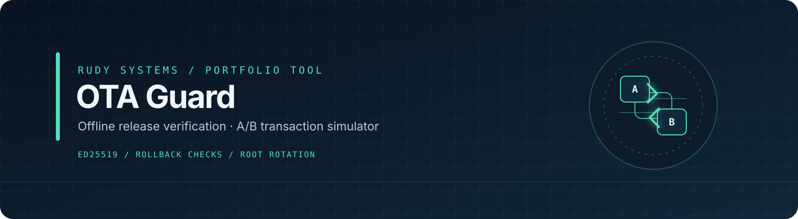

<div align="center">
  
</div>

# RUDY OTA Guard

[](https://github.com/r4venrudy/rudy-ota-guard/actions/workflows/ci.yml)


**An offline, educational release-verification and A/B update transaction simulator.** It checks a signed release against an operator-supplied trust root, device state, and an explicitly supplied payload file. It can model staging, a health-gated commit, abort, and a dual-threshold root-key rotation.

This project demonstrates bounded input handling, Ed25519 signature verification, payload integrity checks, rollback/replay checks, strict state transitions, and adversarial tests. It does not control a device or install an update.

> **Scope:** This is a restricted portfolio format and simulator. It is not secure boot, a production OTA updater, a device-health attestation system, or a TUF/Uptane implementation or certification.

## Quick start

Requires Python 3.11 or newer. The package is `rudy-ota-guard` (version `0.1.0`), imports as `otaguard`, and installs the `ota-guard` command. Ed25519 support uses `cryptography==50.0.2`.

```sh
python -m venv .venv
# Activate the environment, then:
python -m pip install .
python scripts/make_demo.py
```

The demo generator creates a synthetic bundle in `examples/` using the fixed demonstration time `1900000000`: `root.json`, `manifest.json`, `state.json`, `payload.bin`, and `rotation.json`. It does not create committed private keys. The demo is deterministic and offline.

Verify the release and payload:

```sh
ota-guard verify --manifest examples/manifest.json --root examples/root.json --state examples/state.json --payload examples/payload.bin --now 1900000000
```

Stage it, writing the returned state to a **new** file chosen by you:

```sh
ota-guard stage --manifest examples/manifest.json --root examples/root.json --state examples/state.json --payload examples/payload.bin --now 1900000000 > examples/staged-state.json
```

Commit only when the caller says the simulated health check succeeded:

```sh
ota-guard commit --state examples/staged-state.json --healthy > examples/committed-state.json
```

To discard a staged update, write the abort result to a different new file:

```sh
ota-guard abort --state examples/staged-state.json > examples/aborted-state.json
```

Root rotation is also modeled with the explicit supplied time:

```sh
ota-guard rotate-root --manifest examples/rotation.json --root examples/root.json --now 1900000000
```

Commands read their input files and write deterministic JSON to stdout. They do not persist state, write files, generate keys, or use the network. Redirect stdout only to a new output path. **Never redirect over an input or trusted state file.**

## What it checks

- Strict JSON input: duplicate keys, unknown fields, unsupported numeric values, malformed base64, and oversized files fail closed.
- Ed25519 release signatures against an operator-supplied root threshold; duplicate signatures for the same public key do not increase the threshold count.
- Target and architecture binding, release expiry, monotonic sequence, rollback index, and pending-update state.
- Exact payload size and streaming SHA-256 from a regular, non-symlink file path supplied separately from signed metadata.
- A/B staging into the inactive slot, explicit abort, and health-gated simulated commit.
- Root rotation authorized by both the current and proposed root thresholds.

See [the format and state model](docs/format-and-state.md), [threat model and limits](docs/threat-model.md), and [testing guide](docs/testing.md).

## Trust and limitations

The root document is trusted input; signatures do not bootstrap trust in it. The clock (`--now`) is supplied by the caller. Device state is also caller-supplied and has no hardware-backed monotonic storage. The `--healthy` switch is a caller assertion for simulation only, not a health attestation. An operator must protect trust roots, state files, and time sources outside this program.

The format is intentionally restricted and project-specific. Its canonical JSON bytes are not RFC 8785 canonicalization and the project does not claim compatibility with TUF or Uptane. There is no network transport, device integration, bootloader interaction, secure boot, key generation, private-key storage, signing command, or production certification.

## Run tests

```sh
python -m unittest discover -s tests -v
```

The tests use synthetic keys, manifests, payloads, and state. They run locally without network access. CI tests Python 3.11 and 3.13 on Ubuntu, Windows, and macOS.

## Project status

Version `0.1.0` portfolio project. Its scope is to make release-verification and A/B transition assumptions inspectable in a small offline simulator—not to authorize or perform real device updates.

Developed with AI assistance, adversarial regression tests, and review of the trust assumptions. See [contributing](CONTRIBUTING.md) for the development and validation process.

---

<div align="center"><strong>RUDY SYSTEMS</strong> · Explicit trust. Observable decisions.</div>
